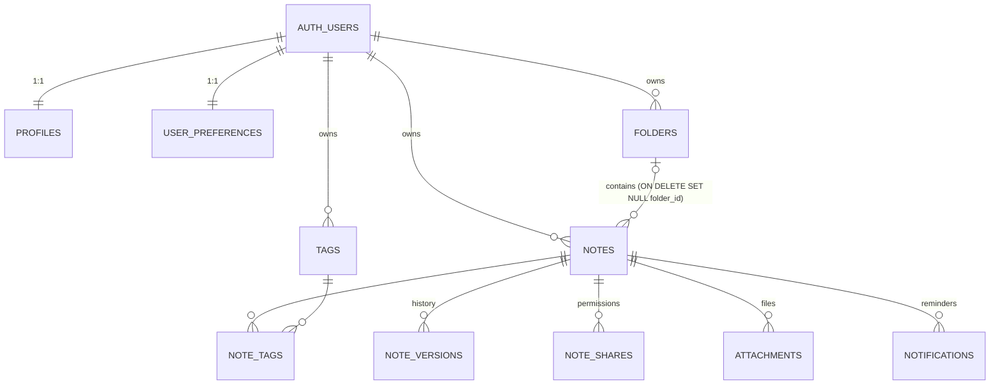

# Noted — Smart Notepad

A private, responsive notepad. **Guests** write immediately (notes stored in this browser's IndexedDB, never uploaded). **Optional free accounts** save notes to Supabase PostgreSQL, protected by Row Level Security, and sync across devices.

Stack: React 19 + TypeScript 6 (strict) · Vite 8 · Tailwind 4 · shadcn/ui (Radix) · Lucide · React Router · TanStack Query · Supabase (Auth, Postgres, RLS) · IndexedDB (`idb`) · Vitest + RTL · Playwright · PGlite (in-process Postgres for RLS tests).

## Quick start

```bash
npm install
npm run dev            # http://localhost:5173 — guest mode works with no configuration
```

To enable accounts, copy `.env.example` to `.env.local` and fill in values from a **development** Supabase project:

```
VITE_SUPABASE_URL=https://<ref>.supabase.co
VITE_SUPABASE_PUBLISHABLE_KEY=<publishable/anon key>
```

Only the publishable key ever goes in the browser. The app refuses to start cloud mode if given a `service_role`/`sb_secret_` key.

## Database setup

1. Create a dedicated Supabase dev project. Don't use production.
2. Review and apply **all five** files in `supabase/migrations/` in filename order. For a new project, use `supabase link --project-ref <ref>` then `supabase db push`. For an existing deployment, preserve its migration ledger and apply only the four new upgrade migrations. Back up the target database first. Do not reapply the initial schema or reset existing data.
3. Auth → URL configuration: set the Site URL and add `<site>/auth/callback` to the redirect URLs.
4. Auth → Email: keep "Confirm email" enabled.

### ERD



Security model:

- RLS is enabled on all 10 public application tables; AI usage counters are in the private schema. `anon` has no privileges.
- `authenticated` gets column-level grants, so `owner_id` can never be inserted or updated by a client.
- A composite FK `(folder_id, owner_id) → folders(id, owner_id)` blocks cross-user folder links.
- A trigger plus RLS block cross-user note↔tag links.
- `note_versions` is read-only to clients. Versions are written only by SECURITY DEFINER functions that check ownership: an automatic checkpoint every ≥10 minutes of edits, a manual one on Ctrl/⌘+S, and restore, which snapshots the current text first.
- Folder and tag names are unique per user, case-insensitive.
- `list_notes_v2` does server-side search/filter/sort/pagination using trigram indexes.

## Scripts

| Command                              | What it does                                                                                                  |
| ------------------------------------ | ------------------------------------------------------------------------------------------------------------- |
| `npm test`                           | Vitest: unit, component and **RLS/security** tests (real migration run in PGlite as the `authenticated` role) |
| `npm run test:e2e`                   | Playwright against the production build, desktop + mobile Chromium                                            |
| `npm run build`                      | Type-check + production build into `dist/`                                                                    |
| `npm run lint` / `npm run typecheck` | ESLint / tsc                                                                                                  |

Cloud E2E (`e2e/cloud.spec.ts`) runs only with `E2E_SUPABASE=1`, a Supabase **test** project and `E2E_USER_A/B_EMAIL/PASSWORD`. Without those it is reported as skipped.

## Architecture

- `src/domain`: shared types plus the `NotesRepository` interface. The UI is storage-agnostic.
- `src/data/local`: IndexedDB guest repository, which mirrors all database rules.
- `src/data/cloud`: Supabase repository.
- `src/data/drafts.ts`: local draft mirror of unsaved edits, so text survives refreshes, crashes and going offline.
- `src/features/notes/noteSaver.ts` (autosave):
  - Debounced, so there's no request per keystroke.
  - One request in flight per note, so stale responses can't overwrite newer text.
  - Optimistic concurrency on `updated_at`: an edit made elsewhere produces a conflict prompt instead of a silent overwrite.
  - Offline: waits for reconnect. Other errors: backoff retry.
  - Warns on unload if anything is unsaved.
- `src/features/migration`: guest → account import.
  - Cloud IDs are deterministic UUIDv5(userId, guestId) and inserts use `ON CONFLICT DO NOTHING`, so an interrupted import can be restarted without duplicates.
  - Folders and tags merge by name; existing cloud notes are never overwritten.
  - Every note is read back and verified before local copies can be removed, and removal is offered, never automatic.

## Keyboard shortcuts

`Alt+N` new note (`Ctrl/⌘+N` is reserved by most browsers) · `Ctrl/⌘+S` save + checkpoint · `Ctrl/⌘+F` focus search (inside the note body the browser's own find is kept) · `Esc` closes dialogs.

## Deployment checklist

1. Review the four additive upgrade migrations (and the initial schema for a new database), then apply the intended pending migrations to the target project. Run `npm test` against those same files.
2. Set `VITE_SUPABASE_URL` and `VITE_SUPABASE_PUBLISHABLE_KEY` (and optionally `VITE_SITE_URL`) in the host's environment.
3. `npm run build`, then serve `dist/` as a static SPA with a fallback to `index.html` (Vercel, Netlify, Cloudflare Pages, etc.).
4. Add the production `/auth/callback` URL to Supabase's redirect URLs.
5. Smoke test: guest note → register → verify email → import → log in on a second device, plus private uploads and share/revoke with two test users.

## Productivity upgrade

Rich text/checklists/tables, favorites/colors, duplication, folder appearance, actual dashboard sections, date/tag/folder search, reminders/inbox, private attachments, voice recording, note links/backlinks, sharing with revision checks, and optional AI are integrated into the existing repositories. Original plain-text notes remain readable. See [the implementation report](docs/IMPLEMENTATION.md) for the complete changed-file list, schema changes, security model and limitations.

Import: TXT, Markdown, DOCX and readable PDF. Export: TXT/ZIP, Markdown, DOCX, and **Print / Save as PDF** through the browser. Unsupported layouts and scanned PDFs are reported honestly. Text backups do not include attachments. Account import keeps guest copies that still have attachments, since files are not transferred automatically.

Production builds include an app-shell service worker. Guest reload/editing works offline once the shell is cached. Signed-in users can edit previously opened owned notes using scoped snapshots and queued text drafts; cloud creation, organization and uploads require connectivity. Shared notes are excluded from the offline snapshot cache. No encryption or password-locking is advertised.

Reminders are checked while Noted is open. Closed-app delivery is not implemented; it requires a scheduled backend and push/email delivery. Voice recording uses MediaRecorder. Live dictation is browser-dependent and may use the browser vendor’s speech service; transcription of existing audio files is not implemented.

### Optional AI deployment

1. Apply the quota migration and configure a Supabase account.
2. Set server-only secrets using a private file copied from `supabase/functions/.env.example`: `ANTHROPIC_API_KEY`, `ANTHROPIC_MODEL`, `ALLOWED_ORIGIN`. Never commit that file or use `VITE_*` for provider keys.
3. Run `supabase secrets set --env-file <private-secrets-file>` and `supabase functions deploy ai-writer` against the intended project.
4. Keep JWT verification enabled. The function also validates the token using Supabase Auth, enforces the exact allowed origin and a 20-request/hour account quota, and sends text only after the user chooses Generate.

Without a deployed function and credentials, AI shows an unavailable state. No provider call has been verified in this workspace. Sharing uses Supabase Realtime when configured, with polling and atomic conflict checks; it does not implement character-level merging/live cursors.

### Verification

See `docs/IMPLEMENTATION.md` for scope and deployment limits. Commands to reproduce:

```bash
npm ci
npm run lint
npm run typecheck
npm test
npm run build
npx playwright install chromium
npm run test:e2e
npm audit
```

Browser tests run desktop and mobile Chromium. Recording tests use a synthetic microphone, not your hardware. Four hosted-cloud cases require credentials and one keyboard-shortcut case is desktop-only. Executed results (8 November 2026):

| Check                                                                       | Actual result                                          |
| --------------------------------------------------------------------------- | ------------------------------------------------------ |
| `npm run lint`                                                              | Passed, no errors or warnings                          |
| `npm run typecheck`                                                         | Passed                                                 |
| `npm test`                                                                  | 115 tests passed in 9 files                            |
| `npm run build`                                                             | Passed; production assets and service worker generated |
| `npm run test:e2e`                                                          | 47 passed, 5 skipped across desktop/mobile Chromium    |
| `npm audit`                                                                 | 0 vulnerabilities                                      |
| `npx --yes --package=deno deno check supabase/functions/ai-writer/index.ts` | Passed                                                 |

The five skipped browser cases are the four hosted-cloud cases without credentials and the mobile-only skip for the desktop keyboard shortcut. No hosted database migration, provider generation or deployment was performed. Full configuration and unfinished capabilities are listed in [the implementation report](docs/IMPLEMENTATION.md).

## Login, Guest Mode and camera scanning

First-time visitors can choose **Log In**, **Create an Account**, or **Continue as Guest**. Guest Mode opens the dashboard and keeps notes in IndexedDB without Supabase. The account menu provides optional login/registration, import/export and local-data information. Settings also supports signing out directly into Guest Mode.

The camera text scanner recognizes printed English locally using Tesseract, with capture, image selection, editable results and saving as a note. `npm run dev` and `npm run build` automatically prepare packaged worker/model assets; recognition works offline once the production app cache is installed. No images are uploaded. Use HTTPS (or localhost) for the camera.

See [the login and Guest Mode report](docs/AUTH-AND-GUEST-MODE.md) for session isolation, safer transfer verification, supported OCR inputs, file changes and actual verification limits. Guest notes were also verified across a complete browser restart. Live Supabase registration, email delivery and cloud-transfer acceptance still need a real test project; no cloud behavior is simulated in the application.
